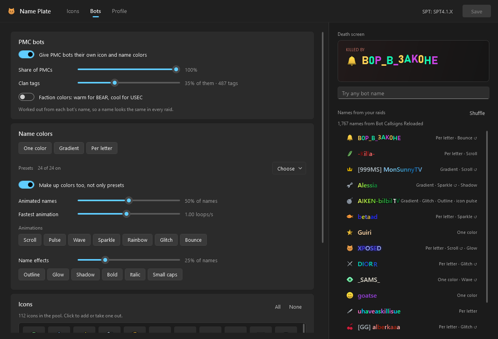

# Name Plate

Make your name stand out in Escape from Tarkov (SPT 4.1). Give your nickname colors, gradients,
animations, a glow and a clan tag. Pick any icon from the game, from a library of 244 extra icons
(32 of them animated) or from a picture of your own. PMC bots get Name Plates of their own too, so
the names on the death screen, the flea market and the dogtags you take aren't all plain gray. With
Fika, Name Plate sharing lets friends who run the mod see your Name Plate, and you see theirs.

Everything is set up in **Name Plate.exe**, an editor with a live preview:


> Name Plate was called **Edition Customizer** before, and grew out of Evgencheg's
> [Tarkov-Change-Icons](https://github.com/Evgencheg/Tarkov-Change-Icons) (the `spt membercategory`
> chat command). Coming from Edition Customizer? See [Updating](#updating-from-edition-customizer).

## What you can do

**Your name**
- One color, a gradient across the name, or a color per letter.
- Animations: scroll, pulse, wave, sparkle, rainbow, glitch and bounce, at any speed and in either direction.
- Effects: outline, glow, drop shadow and italic.
- A clan tag of up to 5 letters or digits: `[EZ] YourName`, in gray, a color of its own, or the name's colors.
- **Surprise me** rolls a whole random Name Plate; press it until one sticks.
- Optionally, your scav's name gets your Name Plate too.

**Your icon**
- Any of the game's own icons (about 1,100 are read straight out of the game files), the 244 library icons, or your own PNGs.
- Recolor the game's member icons, or add brand-new ones next to Standard, Edge of Darkness, Unheard and the rest.
- Animated icons, plus icon effects: pulse, glow, flip and float.
- Hide the prestige badge or swap it for a picture of your own.

**Sharing**
- Save your own presets.
- Copy a Name Plate as a short code that anyone with the mod can paste.
- With Fika, Name Plate sharing shows your Name Plate to the other players on your server.

## Where it shows up

| Where | Whose Name Plate |
| --- | --- |
| Main menu name and icon | yours |
| Settings dropdown, where you pick the icon you show | yours |
| Anywhere else the game draws your member icon next to your name | yours |
| Death screen ("killed by") | the PMC bot that killed you |
| Kill list after a raid | the PMC bots you killed |
| Flea market seller names | PMC bots, matching the PMC of the same name |
| Messages: "your item was bought by…" | the buyer |
| Dogtags you take, on the tile and in the inspect window | the PMC bot it came from |
| Lobby, group and chat lists, invites, death screen, kill list, dogtags (Fika) | the other player's, if they run the mod |

Traders, system messages and chat bots always keep the game's own name and icon, and so do other
players who don't run the mod. A game icon you change (say, Edge of Darkness) changes only for
you, never for everyone who has it.

## Nemesis

A PMC that kills you twice (bot or real player) is marked **NEMESIS** on the death screen, with
the count. Kill someone who has killed you and the kill list says **REVENGE**. The Bots page shows
who has killed you most and sets how many deaths it takes, or turns it off.

## Using the editor

1. Run **Name Plate.exe** from your SPT folder. The first time, it reads the game's icons (a second or two).
2. **Icons page:** pick an icon on the left, or press **New** to make one. Choose its colors,
   animation, effects, tag and picture. The preview at the top shows how it looks on the main menu.
3. **Profile page:** tick the icons your character has and choose the one that's shown. The SPT
   server must be closed for this; the editor backs your profile up first.
4. Press **Save** (Ctrl+S). Ctrl+Z undoes changes to an icon.

You can change your Name Plate while the game is running; reopen a screen to see the change.
Changing which icons a character has needs the server closed and a game restart.

## PMC bots


Bots are on out of the box. Each bot's Name Plate comes from its name, so the same bot looks the
same in every raid, and nothing is stored on bots or profiles. They draw from every library icon
and the member icons, with 24 color presets plus made-up color schemes:
- About half of them have animated names.
- About a third wear a clan tag. There are 487 of them, like `[EZ]`, `[L2P]` or `[1V9]`, so two bots rarely share one. Some tags are colored.
- Some get name effects and icon effects.

The **Bots** page sets how many bots get a Name Plate and which icons, animations and effects they
can use. It can also give BEAR bots warm colors and USEC bots cool ones, or turn bot Name Plates off.



It works with [Bot Callsigns Reloaded](https://sp-mod.com/mod/1873/bot-callsigns-reloaded) and
[Realistic PMC Names](https://sp-mod.com/mod/3064/realistic-pmc-names); the editor previews names
from whichever one you have installed.

## Installation

Needs SPT 4.1.x. The editor also needs the
[.NET 10 Desktop Runtime](https://dotnet.microsoft.com/download/dotnet/10.0); if it's missing,
Windows offers the download when you start the editor.

Unpack `NamePlate-<version>.zip` into your SPT folder (the one with `EscapeFromTarkov.exe`). You should get:

```
Name Plate.exe                                   the editor
SPT_Runtime/user/mods/NamePlate/NamePlate.dll    server mod (the chat command, Name Plate sharing)
BepInEx/plugins/NamePlate/NamePlate.Client.dll   client plugin (icons, colors, bots)
BepInEx/plugins/NamePlate/icons/library/*.png    244 extra icons
```

The zip has no `icons.json`, so updating never overwrites your Name Plates.

### Updating from Edition Customizer

Name Plate is the same mod under a new name.
1. Move `icons.json`, and any PNGs of your own, from `BepInEx/plugins/ChangeIcons` into `BepInEx/plugins/NamePlate`.
2. Delete `BepInEx/plugins/ChangeIcons`, `SPT_Runtime/user/mods/ChangeIcons` and `ChangeIcons Editor.exe`.

If the old copy is still there, the game loads only one of the two and logs why. The server loads
both, and Name Plate's chat command becomes `spt nameplate` (see below).

### Uninstallation

Delete `SPT_Runtime/user/mods/NamePlate`, `BepInEx/plugins/NamePlate` and `Name Plate.exe`.

Your icons stay on the account. To reset them, untick them on the editor's Profile page (or send
`spt membercategory default`) before deleting the mod.

## Chat command

The editor's Profile page does this for you, but the server mod also takes chat commands. Message
**SPT** in your friends list:
- `spt membercategory`: what you have now
- `spt membercategory list`: what you can add
- `spt membercategory unheard+uniqueid+2048`: set your icons by name or number. 2048 and up are new icons you made in the editor.
- `spt membercategory default`: back to what your game edition comes with

Restart the game fully after a change. Trader, Group, System and other service flags can't be set,
because they break the profile.

With Evgencheg's original ChangeIcons installed too (it has `spt membercategory` as well), the
command is `spt nameplate` instead, and the server log says so. Name Plate does everything
ChangeIcons does, so you can remove ChangeIcons.

## Compatibility

- **Fika:** checked against Fika 2.4.4 at the code level; not yet tested in a live co-op session.
  - The two never patch the same thing in conflicting ways, and custom icon flags travel through Fika's profile sync untouched.
  - Real players are never given bot Name Plates. Human PMCs carry a different role from bot PMCs, and the plugin remembers the people it meets in raids and on your friends list (`players.json`).
  - Name Plate sharing goes through the host's server: each game sends its own Name Plate when it changes and fetches everyone else's (`shared-nameplates.json` in the server mod's folder; your own pictures go along, the library ones don't need to). Turn it off on the editor's Profile page.
  - Other players see your Name Plate only if they run the mod; without it, they see the game's name and icon. If the host lists this mod as required, everyone needs the same version.
  - Fika's nameplates for its own developers borrow the Developer and Edge of Darkness pictures, so a picture you changed there shows on those plates too.
- **MoxoPixel's Menu Overhaul:** its main-screen name gets your icon and colors when the icon you show is one you've changed.
- **Limit:** the settings dropdown draws its small icon from a fixed sprite sheet. There, a new icon shows as its name only, and a replaced icon keeps the game's small picture.

## Building

```
dotnet build src/NamePlate/NamePlate.csproj -c Release
dotnet build src/NamePlate.Client/NamePlate.Client.csproj -c Release -p:SPTPath="C:\SPT" -p:DeployToSPT=true
dotnet publish src/NamePlate.Editor/NamePlate.Editor.csproj -c Release -o dist/editor
python scripts/make_icons.py          # the icon library
python scripts/make_app_icon.py       # the editor's icon
```

- Needs the .NET 10 SDK.
- The client plugin compiles against the install's patched `Assembly-CSharp`, so that SPT install must have been launched once. This is also why only the server mod builds on GitHub Actions.
- The version is set once, in `Directory.Build.props`. To make a release zip, run `.\scripts\package.ps1 -SPTPath C:\SPT`; it writes `dist\NamePlate-<version>.zip`.

How it works, for anyone reading the code:
- The game's member icons live in one table (`ChatSpecialIconSettings`). The plugin edits that table and adds rows for new flags (2048, 4096, …).
- Name colors are drawn by recoloring TextMeshPro's vertices.
- Bot Name Plates are worked out in `src/Shared/BotLooks.cs`. The plugin and the editor compile the same file, so the editor's preview matches the game.
- Name Plate sharing: `src/NamePlate/SharedNamePlates.cs` and `ShareRouter.cs` on the server, `src/NamePlate.Client/SharedNamePlates.cs` in the plugin.
- The editor reads the game's files with [AssetsTools.NET](https://github.com/nesrak1/AssetsTools.NET). `src/NamePlate.Editor/Assets/classdata.tpk` is its class database, from [UABEA](https://github.com/nesrak1/UABEA) (MIT).

## Reporting a bug

Open an issue with your `BepInEx/LogOutput.log`. For Name Plate sharing on Fika, attach the log
from both players and the host's server console. The plugin's lines starting with
`[Name Plate sharing]` say what it sent, what the server holds, who in your raid shares a Name
Plate, and whose it drew; the server prints a `Name Plate sharing:` line each time one arrives.

## Credits

- Evgencheg: the original Tarkov-Change-Icons
- JoelHauser: Name Plate
- Made with help from an AI coding assistant

[MIT](LICENSE)
