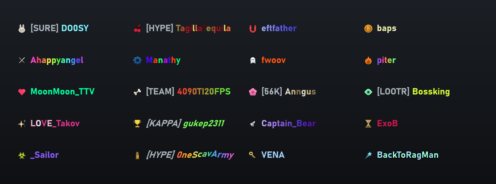
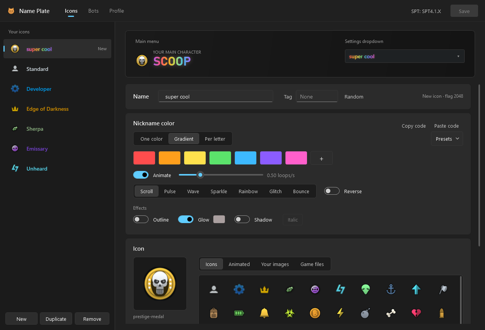

# Name Plate

**Make your name stand out.** Colors, animations, glow, clan tags and custom icons for your
nickname, plus a desktop editor to set it all up with a live preview. PMC bots get Name Plates of
their own too, so the names you run into aren't all plain gray.

## What you can do

**Your name**
- One color, a gradient, or a different color for every letter
- Animations: scroll, pulse, wave, sparkle, rainbow, glitch and bounce
- Outline, glow, drop shadow and italic
- A clan tag in front of your name, like **[EZ] YourName**, in any color
- **Surprise me**: a random Name Plate in one click

**Your icon**
- Any of the game's ~1,100 icons, 244 extra icons (32 animated), or your own PNG
- Make brand-new icons, or recolor the existing ones (Standard, Edge of Darkness, Unheard…)
- Icon effects: pulse, glow, flip and float
- Hide the prestige badge, or swap it for your own picture

**Share it**
- Save your own presets
- Copy your Name Plate as a short code that friends can paste into their editor
- **Name Plate sharing** (Fika): friends who also run Name Plate see yours, and you see theirs

## Where it shows up

**Your Name Plate**
- Main menu name and icon
- The settings dropdown where you pick your icon
- Everywhere else the game shows your member icon
- Your scav's name, if you want

**PMC bots' Name Plates**
- Death screen: the bot that killed you
- Kill list after the raid
- Flea market seller names
- Messages: "your item was bought by…"
- Dogtags you take, on the item and in the inspect window

**Other players' Name Plates (Fika)**
- Friends list and chat, invites, death screen, kill list, dogtags and flea offers

Every bot's Name Plate comes from its name, so you'll recognize the same PMC from raid to raid.
About a third wear a clan tag, drawn from nearly 500 like **[EZ]**, **[L2P]**, **[1V9]** or **[GGEZ]**.
Traders and system messages keep the game's own name and icon.

**Nemesis**: a PMC that keeps killing you is marked **NEMESIS** on the death screen, and when you
finally get them, the kill list says **REVENGE**.

## How to use it

1. Unzip into your SPT folder (the one with `EscapeFromTarkov.exe`).
2. Run **Name Plate.exe** from that folder.
3. **Icons:** pick an icon, or press **New**. Choose colors, animation, effects, tag and picture.
4. **Profile:** tick the icons your character has and pick the one to show. The SPT server must be closed for this step.
5. Press **Save** and start the game.

You can tweak your Name Plate with the game running; reopen the screen to see it. On the **Bots**
page you choose how many bots get a Name Plate and what they can use, or turn bot Name Plates off.

## Requirements

- SPT 4.1.x
- The editor needs the [.NET 10 Desktop Runtime](https://dotnet.microsoft.com/download/dotnet/10.0); Windows offers it if it's missing.

## Good to know

- **Fika:** for Name Plate sharing, every player needs Name Plate, and the host's server needs its server part (it's in the same zip). A Name Plate made in the editor on the host (headless too) reaches its player's own PC. Real players never get bot Name Plates. You can stop sharing yours on the editor's **Profile** page.
- Works with Bot Callsigns Reloaded, Realistic PMC Names and MoxoPixel's Menu Overhaul.
- **Updating from Edition Customizer?** It's the same mod, renamed. Move your `icons.json` from
  `BepInEx/plugins/ChangeIcons` to `BepInEx/plugins/NamePlate`, then delete the old ChangeIcons folders and `ChangeIcons Editor.exe`.

## Found a bug?

Post it in the comments or on [GitHub](https://github.com/JoelHauser/EditionCustomizer/issues) with your
`BepInEx/LogOutput.log`. For Name Plate sharing, send the log from both players plus the host's server
console: lines starting with **[Name Plate sharing]** show what was sent, received and drawn.

Based on Evgencheg's Tarkov-Change-Icons. Source: https://github.com/JoelHauser/EditionCustomizer
